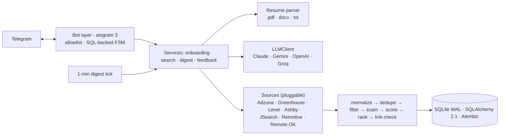

# JobPilot

**A personal AI job-search agent with a Telegram front end.** Send it your resume and it asks only what it couldn't infer. It then searches legitimate job APIs, drops duplicates, stale posts and scams, explains why each match fits and what's missing, and sends a daily digest of *new* matches only. It never applies on your behalf.

<!-- After pushing to GitHub, add:  -->
<!-- Demo: record the Telegram flow (synthetic resume) and save as docs/demo.gif -->

```
You ──▶ /start ──▶ send resume (PDF / DOCX / text)
        ◀── "Here's what I understood" (roles, level, top skills) [Looks right] [Fix something]
        ◀── 8–10 quick questions (only what the resume didn't answer), Skip / Back, restart-safe
        ◀── Search plan ──▶ [Start search]
        ◀── 🟢 87% match · Backend Engineer (Python)        ← job cards with Apply / Save /
            🏢 Acme · 📍 Hyderabad (Hybrid) · 💼 Full-time      Not interested / More like this
            💰 ₹12–18 LPA · 🕒 Posted 2 days ago · via Greenhouse
            Why it fits • FastAPI + PostgreSQL match your WhatsApp-bot project …
            Gaps: Kubernetes · Pitch: Lead with your production automation work.
        ◀── every morning: new matches only (or "no strong new matches today; 143 checked")
```

## How it works



### How matching works
1. **Sources.** The AI writes 3–6 diverse queries (role synonyms × cities × level). Adzuna/JSearch search server-side. 21 verified company boards (Greenhouse, Lever, Ashby: Stripe, Databricks, MongoDB, CRED, Paytm, Groww, Sarvam AI…) are fetched once per 6 h and filtered locally. Quotas are tracked per day and month; a source near its limit is skipped, not failed.
2. **Normalize and dedupe.** HTML becomes text and salaries/locations are normalized (Bangalore = Bengaluru, Gurgaon = Delhi NCR). Duplicates are caught by exact fingerprint plus fuzzy company/title matching. The best apply link wins: direct ATS > company site > aggregator.
3. **Hard filters (no AI).** Already seen, older than 14 days, wrong work mode, location or region, excluded companies or keywords, missing must-haves, seniority far off, or salary below your minimum (only when stated, and never on estimates).
4. **Scam check.** Fees or deposits, WhatsApp-only contact or no company name mean the job is dropped. Short descriptions, personal recruiter emails or unrealistic pay get a ⚠️ badge.
5. **Stage 1 (local, free).** Embedding similarity (bge-small, on-device) + evidence-weighted skill overlap + title fit + learned feedback weights. Keeps the top 30.
6. **Stage 2 (AI rubric, batched 5 per call).** The AI scores sub-scores and writes the reasons; **code** clamps them and computes the total:

   | Criterion | Points |
   |---|---|
   | Skills match (weighted by where the skill is proven) | 0–40 |
   | Role fit | 0–20 |
   | Seniority fit | 0–15 |
   | Location / work-mode fit | 0–10 |
   | Preference fit (company type, salary, keywords) | 0–10 |
   | Freshness (computed in code) | 0–5 |

   Cards are sent at **≥ 60**. If the AI is unavailable or the daily budget is spent, stage-1 "basic match" scores are used, with their own calibrated threshold.
7. **Link health.** Aggregator links get a streamed GET; only 404/410 drop a job. ATS links are live by definition.
8. **Learning.** *Save* / *More like this* boost similar titles. *Not interested* asks why and adjusts: a role reason penalizes similar titles, repeated location reasons tighten cities, a company reason offers to exclude it. `/preferences` lists every change in plain English.

## Engineering highlights
- **Fully async Python 3.13**: aiogram 3, SQLAlchemy 2.1 async, httpx; one process runs the bot and the scheduler.
- **Restart-safe conversations**: a custom SQL-backed aiogram FSM storage. A test kills the dispatcher mid-questionnaire and resumes.
- **Provider-agnostic AI with strict JSON**: one schema works with Claude `output_config`, OpenAI/Groq strict `json_schema` and Gemini `response_json_schema`, plus a validate-and-repair loop.
- **"LLM extracts, code computes"**: years of experience (overlaps merged, internships separate), seniority, totals and freshness are computed by code. Skills the resume doesn't evidence are dropped.
- **Works without an AI key**: rule-based resume parsing and basic scoring keep the pipeline running end to end.
- **Prompt-injection defences**: untrusted resume and job text is fenced, embedded closing tags are neutralized, prompts say "data, not instructions", and outputs are schema-validated. Injected "20 years of experience" claims can't change the computed level.
- **Cost guard**: per-run token cap plus a daily USD budget from a pricing table; spend is shown in `/stats`.
- **Reliability**: per-source isolation, retries with backoff, response cache, per-user locks, a rate-limited Telegram send queue (flood-wait aware), coalesced digest catch-up after the laptop sleeps, a duplicate-poller watchdog (aiogram retries 409s forever by default), and offline-tolerant startup.
- **Privacy**: owner-only allowlist; logs redact tokens, keys, emails, phones and resume/job text; data lives outside the repo; `/deleteme` wipes everything.
- **Tested without network**: 204 tests, 92% coverage. The real dispatcher runs against a fake Telegram API, HTTP is mocked with respx, migrations are checked against the models for drift, and a matching **quality gate runs in CI**.

## Metrics
**Matching eval** (`python -m jobpilot eval`, 30 hand-labeled resume↔job pairs in [`evals/dataset.yaml`](evals/dataset.yaml)). The baseline below is offline (lexical embedder, no AI), the floor CI enforces:

| Persona | P@5 | P@10 | Pairwise accuracy | Spearman ρ |
|---|---|---|---|---|
| Fresher, backend/AI | 0.80 | 0.40 | 1.00 | 0.84 |
| Mid data analyst | 0.60 | 0.30 | 1.00 | 0.87 |

P@5 is at its ceiling: only 4 and 3 jobs, respectively, are labeled *good*. Re-run with `--local-embeddings --ai` for the full-pipeline numbers. Full ranking tables are in [`evals/RESULTS.md`](evals/RESULTS.md).

**Cost**: Claude Haiku 5.5 is $0.10 / $0.50 per million input/output tokens. A full search scores ≤ 30 jobs in 6 calls (≈ 45k in + 9k out), roughly **$0.009**. Digests only score *new* jobs. Live per-run numbers (jobs scanned, dedupe rate, cost) are in `/stats`.

## Quick start
```text
1. Create a bot with @BotFather and send it /start
2. Windows: powershell -ExecutionPolicy Bypass -File .\setup.ps1     (Linux/macOS: ./setup.sh)
3. Fill in .env when it opens (bot token, LLM_API_KEY for Claude); setup saves your Telegram ID
4. uv run python -m jobpilot doctor
5. uv run python -m jobpilot run      (or install-autostart.ps1 to start at every login)
```
Full guide: [docs/SETUP.md](docs/SETUP.md). Always-on hosting: `docker compose up -d`.

## Commands
`/start` status and menu · `/new` new resume · `/profile` · `/preferences` · `/search` · `/pause` · `/resume` · `/saved` · `/history` · `/stats` · `/settime` · `/deleteme` · `/help`

CLI: `python -m jobpilot run | doctor [--sources] | migrate | whoami [--save] | companies | eval [--ai] [--local-embeddings] | version`

## Rules it follows
It never applies to jobs. It uses official/public APIs only (no LinkedIn/Naukri/Indeed scraping), every card has a working apply link, the same job is never shown twice, it asks before searching, it explains every match, it answers only the owner, and resume data stays local except for AI parsing and scoring.

## Project layout
```
jobpilot/  bot/ (handlers, FSM storage, delivery)  services/ (profile, preferences, search, feedback, cost, stats)
           resume/ (extract, schema, profile)  sources/ (adzuna, boards, jsearch, remote_boards, http, registry)
           matching/ (normalize, locations, skills, dedupe, filters, scam, scoring, links)
           llm/ (base, providers, prompts/*.md, embeddings, fake)  db/ (models, migrations)  scheduler/
tests/     unit/ integration/ fixtures/ (synthetic resumes)   evals/   docs/ (SETUP, ARCHITECTURE, DECISIONS)
```

## Roadmap
Web dashboard · multi-user SaaS mode (needs Adzuna/JSearch commercial licences) · cover-letter drafts per job · application tracker built on the *Applied* button · webhook mode for always-on hosts.

## License
MIT
